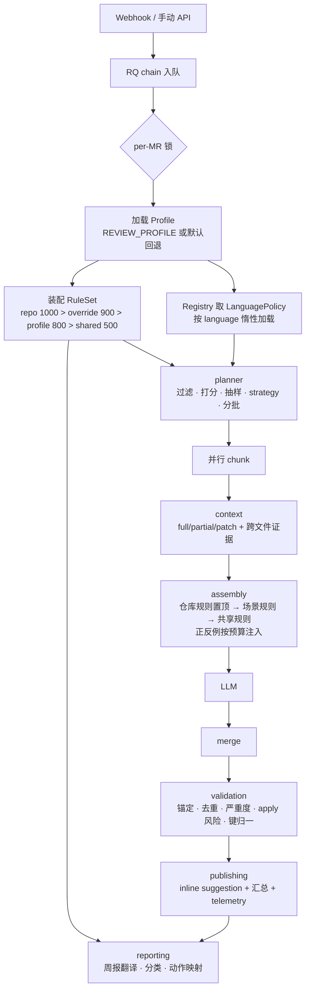

# 通用检视场景包架构（Profile-based Review）设计文档

- 日期：2026-11-07
- 分支：new_review_v2（基于 main 新建）
- 状态：已与需求方分段确认；已完成完整性/矛盾核查、分层评审、规则层评审、Python/C++ 解耦评审与严格兼容性审计；首期仅 Python 场景（C/C++ 仅预留接口），待审阅

## 1. 背景与问题

ReviewAgent 当前是「SSD 自动化测试（Python）MR 检视」专用系统：

- 20 条 R-* 通用规则硬编码在 `prompts/_general_rules_block.md`，带大量 SSD 硬件 / pytest 场景假设；
- prompt（`prompts/improve.md`、`describe.md`）及三个 weekly prompt 中角色、示例、缩进约定均写死 Python 测试语境；
- 语言假设散落在核心代码：`commands/improve.py` 中的 ast 符号校验（:1975-2300）、`rg -t py` 跨文件检索（:718,795）、pytest 关键词密度打分（`config.py:140-149`）、4 空格缩进约定（prompt :323）、规则键正则写死 `SSD-RULE-`（:86-96）；
- `commands/improve.py` 为 3354 行巨石模块，prompt 装配、调度、校验、发布、去重全部耦合；
- 周报链路除规则解析外仍写死：标题（`reporting/config.py:50,79`、`artifact.py:49,80,103`）、规则→ruff 动作映射（`renderer.py:477-484`）、代码文件扩展名与入口文件优先名（`collectors/repo_scan.py:298,315`）、三个 weekly prompt 的 SSD 语境；
- 规则知识三处散落：prompt Markdown、`repo_context.py`（仓库规则）、`rule_translate.py`（反向正则解析规则名），换场景必然漏改；
- 配置纯环境变量，无场景切换概念。

目标：框架不变、场景可变——**切换场景包即可适配不同检视场景与检视质量**，规则可独立配置，架构可扩展。

## 2. 需求决策（已确认）

| 决策点 | 结论 |
|---|---|
| 场景切换作用域 | **部署实例级**：一个实例服务一种场景，环境变量选择 |
| C/C++ 检视结果形态 | 保留**可 Apply 的 GitLab suggestion**（同现有）；首期不实施 |
| 现有 Python 检视兼容性 | **行为严格兼容**：现有测试全绿、断言零改动、渲染后 prompt 逐字节一致、规则正文逐字节迁入 |
| 规则配置形态 | **Markdown 规则包** + 可解析元数据（frontmatter / 规则表 / 正反例）；支持 `verbatim` 兼容渲染与 `structured` 结构化渲染 |
| 规则层 | **独立子系统**：完整模型（RulePack/Rule/RuleSet）、四层来源装配、适用性过滤、覆盖/禁用、键索引 |
| 仓库自定义规则 | **独立模块**处理被检仓库 AGENTS.md / `.agents/rules`，优先级第一 |
| 规则正反例 | **支持**：每条规则可选附带反例/正例，按 prompt 预算注入 |
| Profile 语义 | **场景包**（非语言包）：语言只是属性，同语言可有多场景 |
| `REVIEW_PROFILE` 未设置 | **默认回退 `ssd-python-autotest` 并记 warning**；显式设置了不存在的值才启动失败 |
| 测试耦合处理 | **兼容门面**：`ImproveCommand` 保留同名私有方法（仅委托）与模块级 `config` 引用，现有测试耦合零改动 |
| 检视数据存储 | **一实例一库**：文档强制 `REVIEWAGENT_DATA_DIR` 按实例隔离，schema 不改 |
| 周报场景化 | **全量纳入场景包**：三个 weekly prompt、规则→动作映射、repo_scan 扩展名、标题 |
| env 与 profile 优先级 | **显式 env > profile.yaml > 内置默认值** |
| 首期实施范围 | **仅 Python 场景**：C/C++ 仅预留接口与设计，稳定后再实施 |
| 分层修正 | 新增 `scenario/` 共享层；`review/` 拆 planner/context/runner；`reporting` 不依赖 `review` |
| 语言隔离原则 | **语言差异唯一出口**：只允许出现在 `review/policies/` 与 `profiles/`；共享引擎禁止语言分支与语言字面量（`.py` / `-t py` / `ast` / `if language ==`） |
| 解耦验收 | **架构守卫测试 + 探针场景**：用测试专用第二场景证明「零改共享代码可接入」，不实现 C/C++ |
| 规则隔离 | **加载时命名空间校验**：键不匹配 profile 的规则包在装配阶段拒绝；`_shared` 包必须声明 `applies_to.languages`；RuleSet 按 profile 独立、不可变 |
| 零改动表述 | 改为可验证承诺：**预期零改动**；确需新增共享能力时，只能是语言无关的通用钩子，且 Python golden 与探针场景双通过 |
| 质量不打折 | **三重基线**：prompt golden 字节一致 + 规则内容 checksum + 历史 MR 回放对比（建议数/严重度分布人工签字） |

## 3. 非目标

- 不做仓库级 profile 自动发现（实例级已确认；仓库级留作后续演进）。
- 不做规则 DSL / 规则引擎执行（规则只描述，由 LLM 判读）。
- 不做 C/C++ AST 级符号校验。
- **首期不实施 C/C++ 场景**：`cpp-generic-dev` 场景包、`policies/cpp.py`、C++ 周报内容、`repo_scan` 的 C/C++ 扩展名均推迟；本期只保证接口可承载。
- 探针场景只是 `tests/fixtures/profiles/` 下的测试夹具，不进入 `profiles/`、不参与部署，也不属于 C/C++ 实施。
- 不做跨场景规则的运行时合并：RuleSet 一次只装配当前 profile，实例间互不可见。
- 不改 webhook / RQ / GitLab / LLM provider 的外部接口；telemetry 表结构不变（靠一实例一库隔离场景）。

## 4. 分层架构

### 4.1 分层与依赖方向（L0–L6）

```
L5 入口层      webhook/ · api/
L4 命令任务层  commands/ · workers/
L3 检视引擎层  review/（types · planner · context · assembly · runner · policy · validation · publishing）
L2 场景装配层  scenario/（profile · prompts · rules 子系统）
L1 场景数据层  profiles/（profile.yaml · prompts/ · rules/）
L0 平台层      config · logging · metrics · telemetry · gitlab · llm · git（凭据与运行参数）
L6 报告层      reporting/（依赖 L1/L2；禁止 import review）
```

依赖规则（单向）：

- `commands/workers → review → scenario → L0`；
- `reporting → scenario`（只消费 RuleSet/Profile，不碰检视引擎）；
- `scenario → L0`；`review` 不得被 `scenario` 反向依赖；
- 入口层依赖命令/任务层；启动期可调用 `scenario` 加载器与 `review/policies/registry.py` 做校验，但不执行业务逻辑；
- `review` 共享模块（planner/context/assembly/runner/validation/publishing）**不得 import `review/policies/*`**，只能调用构造时注入的 `LanguagePolicy`；
- `review/policies/*` 可依赖 `scenario` 的模型与 profile 数据，但不得依赖 `commands/workers/reporting`；
- 共享代码内禁止语言字面量：`.py`、`-t py`、`ast`、`if language == ...`；语言差异只允许存在于 `review/policies/` 与 `profiles/`；
- `profiles/` 是纯数据目录，不得包含可执行代码。

### 4.2 目标目录

```
reviewagent/
├── profiles/                     # L1 场景数据（纯数据）
│   ├── _shared/
│   │   ├── rules/                # 共享领域规则库（必须声明 languages）
│   │   └── prompts/              # 可选默认模板（未配置时回退）
│   └── ssd-python-autotest/
│       ├── profile.yaml
│       ├── prompts/improve.md, describe.md, weekly_*.md
│       └── rules/*.md
├── scenario/                     # L2 场景装配
│   ├── profile.py                # 加载/校验/env 合并/单例
│   ├── prompts.py                # 原 prompts/loader，按 profile 解析模板
│   └── rules/                    # 规则层（独立子系统）
│       ├── model.py              # RulePack / Rule / RuleSet
│       ├── parser.py             # Markdown 包解析
│       ├── resolver.py           # 四层来源装配/覆盖/禁用/适用性
│       ├── render.py             # prompt 渲染（仓库规则置顶、预算裁剪）
│       ├── keys.py               # 规则键正则生成与索引
│       └── repo.py               # 被检仓库规则获取（原 repo_context）
├── review/                       # L3 检视引擎
│   ├── planner.py                # 文件过滤/打分/抽样/strategy/分批（纯计算）
│   ├── context.py                # full/partial/patch 源块、跨文件证据、锚点块
│   ├── assembly.py               # prompt 纯函数装配（不调 LLM）
│   ├── runner.py                 # 流水线编排（planner→context→assembly→chunk→merge）+ 并行/预算
│   ├── policy.py                 # LanguagePolicy 协议 + GenericPolicy 默认实现
│   ├── types.py                  # FileKind / FileContext / Suggestion / RiskVerdict
│   ├── policies/                 # cpp 仅预留注册位，首期不创建文件
│   │   ├── registry.py           # language → policy 惰性加载（唯一语言分发点）
│   │   └── python.py             # 全部 Python 语义：AST/rg/密度/缩进/打分/关键字
│   ├── validation.py             # 行号校验、锚定、去重指纹、键归一（委托 policy）
│   └── publishing.py             # inline suggestion + 汇总评论（合并 publish_overview）
├── commands/
│   ├── improve.py                # 薄壳 + 兼容门面（委托）
│   └── _common.py                # 通用命令生命周期（telemetry/workspace/异常）
├── repo_context.py               # 兼容 re-export（实现迁入 scenario/rules/repo.py）
├── prompts/loader.py             # 兼容 re-export（实现迁入 scenario/prompts.py）
├── reporting/                    # L6，依赖 scenario
└── ...

tests/
├── architecture/                 # 解耦守卫：import 方向 / 语言字面量 / 规则命名空间
├── fixtures/profiles/probe-scenario/  # 测试专用第二场景（不是 C/C++）
└── golden/prompts/ssd-python-autotest/  # prompt 字节级基线
```

### 4.3 框架总图

```text
┌──────────────────────────────────────────────────────────────────────────────┐
│ L5 入口层                                                                    │
│   webhook/（MR · Push · Note）          api/（runs · MR · suggestions · weekly）│
└───────────────────────────────┬──────────────────────────────────────────────┘
                                │ 入队 / 查询
┌───────────────────────────────▼──────────────────────────────────────────────┐
│ L4 命令任务层                                                                │
│   commands/improve（薄壳 + 兼容门面）· describe · suggestion_actions         │
│   workers/tasks（RQ chain · per-MR lock · weekly queue）                      │
└───────────────────────────────┬──────────────────────────────────────────────┘
                                │ 构造时注入 Profile + RuleSet + LanguagePolicy
┌───────────────────────────────▼──────────────────────────────────────────────┐
│ L3 检视引擎 review/（语言无关）                                              │
│                                                                              │
│   planner ─► context ─► assembly ─► runner ─► validation ─► publishing       │
│      ▲          ▲          ▲          ▲           ▲              ▲           │
│      └──────────┴──────────┴──── policy.py ──────┴──────────────┘           │
│                    （9 个钩子；policies/python.py 是唯一 Python 实现）        │
└───────────────────────────────┬──────────────────────────────────────────────┘
                                │ 只读装配结果，不反向依赖
┌───────────────────────────────▼──────────────────────────────────────────────┐
│ L2 场景装配 scenario/                                                        │
│   profile.py（加载/校验/env 合并）      prompts.py（模板加载与渲染）          │
│   rules/（model · parser · resolver · render · keys · repo）                 │
└───────────────────────────────┬──────────────────────────────────────────────┘
                                │ 纯数据
┌───────────────────────────────▼──────────────────────────────────────────────┐
│ L1 场景数据 profiles/                                                        │
│   ssd-python-autotest/（profile.yaml · prompts/ · rules/）                   │
│   _shared/rules/（必须声明 applies_to.languages）                             │
└───────────────────────────────┬──────────────────────────────────────────────┘
                                │
┌───────────────────────────────▼──────────────────────────────────────────────┐
│ L0 平台层  config · logging/metrics · telemetry · gitlab · llm · git         │
└──────────────────────────────────────────────────────────────────────────────┘

L6 报告层 reporting/ ── 只依赖 L1/L2 的 Profile + RuleSet ──► 周报 Markdown/Excel
```

### 4.4 检视流水线图



### 4.5 模块职责与变更边界

| 模块 | 只负责 | 允许因何变更 | 不得包含 |
|---|---|---|---|
| `profiles/` | 场景数据 | 新增/调整场景 | 代码 |
| `scenario/profile.py` | 加载、校验、env 合并 | profile 规范演进 | 检视流程 |
| `scenario/prompts.py` | 模板加载与变量校验 | 模板机制演进 | LLM 调用 |
| `scenario/rules/*` | 规则解析、装配、渲染、键索引、仓库规则 | 规则层演进 | 语言实现细节 |
| `review/planner.py` | 文件过滤、打分、抽样、strategy、分批 | 调度策略演进 | 语言语法判断 |
| `review/context.py` | 源块、证据块、锚点块 | 上下文策略演进 | 语言特定检索 |
| `review/assembly.py` | prompt 纯函数装配 | 输出结构演进 | LLM 调用、IO |
| `review/runner.py` | 流水线编排（planner→context→assembly→chunk→merge）、并行、预算 | 执行/编排策略演进 | 语言语义 |
| `review/validation.py` | 锚定、去重、严重度、键归一 | 校验策略演进 | AST/语言判断（委托 policy） |
| `review/publishing.py` | suggestion、汇总、telemetry 写入 | 发布策略演进 | 规则解析 |
| `review/policies/*` | **全部语言差异** | 新增语言/语言规则变化 | 流程编排、发布 |
| `commands/*` | 生命周期与依赖组装 | 入口变化 | 检视业务逻辑 |
| `reporting/*` | 周报采集、渲染、推送 | 报告形态演进 | 检视引擎调用 |

### 4.6 新增场景接入清单

1. 新建 `profiles/<scenario>/profile.yaml`：`language`、prompts、rules、rule_keys、capabilities、file_filter、scoring、reporting。
2. 放入 `prompts/`：improve、describe、三个 weekly 模板（可复用 `_shared/prompts/`）。
3. 放入 `rules/`：规则包声明 `applies_to` 与 `render` 模式；共享包只从 `_shared/` 引用。
4. 新增 `review/policies/<language>.py`：只覆盖有差异的钩子，并在 registry 注册。
5. 不改共享模块；确需新增通用能力时按 §7.5 执行。
6. 跑架构守卫 + 场景端到端 + golden/回放，然后部署（独立实例与数据目录）。

## 5. Profile（场景包）规范

### 5.1 目录与选择

- 场景 = 一个目录，含 `profile.yaml` + `prompts/` + `rules/`。
- 实例选择：环境变量 `REVIEW_PROFILE`（场景目录名或绝对路径）。
  - 未设置 → 载入 `ssd-python-autotest`，日志 WARNING；
  - 设置为不存在的目录 → 启动即失败，列出可用场景及 `description`；
  - 必填字段缺失 → 启动即失败，列出缺失字段；
  - `language` 未注册 → 由入口启动期调用 `review/policies/registry.py` 校验，失败中止启动（`scenario` 不 import `review`）。
- 加载时机：`config` 先完成 env 解析，随后由入口显式初始化 `scenario/profile.py` 单例（API `main.py` lifespan、`rq_worker.py` bootstrap、CLI）；`config` 不得 import `scenario`，避免循环依赖。
- 启动时同步装配并校验当前 profile 的 RuleSet（场景包 + 共享包 + 覆盖/禁用：解析、命名空间、共享包声明）；任何错误 fail-fast。仓库规则在每次 MR 执行时获取，合并为请求级 RuleSet（priority=1000），失败按 §9 降级。
- **双进程一致性**：RQ job 载荷新增 `profile` 字段；worker 执行前校验与自身场景一致，不一致标记失败并记录日志。

### 5.2 profile.yaml 示例

```yaml
name: ssd-python-autotest
description: SSD 自动化测试 Python 代码检视（现有行为）
language: python
prompts:
  improve: prompts/improve.md
  describe: prompts/describe.md
  weekly_inspection_summary: prompts/weekly_inspection_summary.md
  weekly_change_summary: prompts/weekly_change_summary.md
  weekly_quality_scan: prompts/weekly_quality_scan.md
rules:                          # 场景规则包（按顺序，frontmatter 决定优先级）
  - rules/general_rules.md      # render: verbatim（逐字节兼容）
  # - ../_shared/rules/ssd_storage.md   # 后续复用示例；首期不启用，避免新增规则改变检视结果
rule_overrides: {}              # 首期留空以保持行为不变（示例：R-LOG: {severity: high, weight: 1.2}）
disable: []                     # 场景级禁用规则键
repo_context:                   # 仓库规则（第一优先）
  files: [AGENTS.md]
  rules_dir: .agents/rules
  max_lines: 2000               # = 现网 repo_context_max_lines；不得调低以免截断仓库规则
rule_keys:
  # Python 场景沿用现有匹配行为（含 \b 边界）；C++ 场景后续改为 CPP 命名空间
  builtin_pattern: '(?:R-OTHER-IMPACT:[a-z0-9_]+|R-OTHER:[a-z0-9_]+|R-[A-Z]+(?:-[A-Z0-9_]+)*)'
  repo_prefix: SSD              # 仓库规则键 = SSD-RULE-<KEY>
  display_prefix: SSD           # 周报分类/展示前缀
rule_key_promotions:            # 跨来源键提升（替代 publishing 硬编码）
  - when_any: ["wildcard"]       # header / rationale 命中任一词
    to_key: SSD-RULE-FORBIDDEN-WILDCARD-IMPORT
  - when_all: ["from ", "import *"]
    to_key: SSD-RULE-FORBIDDEN-WILDCARD-IMPORT
capabilities:                   # 能力开关；具体实现由 policy 提供，不在此重复
  ast_validation: true
  cross_file_search: true
  apply_suggestion: true
  full_source_analysis: true
file_filter:
  include_extensions: null      # null=不做白名单（保持现网行为）；C++ 等新场景可设白名单
  exclude_extensions: [.md, .doc, .docx, .txt, .rst, .csv, .png, .jpg, .jpeg, .gif, .svg, .ico]  # = 现网 review_exclude_extensions
  skip_paths: [tests/, /tests/, test_, _test., .test., conftest.py]   # = Config.from_env() 回退值
  priority_paths: [/services/, /api/, /core/, /main., /models/, /handlers/, /routers/]  # = Config.from_env() 回退值
scoring:
  feature_keywords: null        # null → 继承 config 默认（现 pytest 关键词）；[] 才是显式清空
  test_paths: [tests/, test_*.py]
  priority_weights: {diff: 20, keyword: 25, density: 20, test_feature: 15}  # = Config.from_env() 回退值
  review_mode: auto             # = Config.from_env() 回退值；显式 env 仍优先
  test_sample_paths: []         # 空=不抽样，与现网默认一致
  test_sample_max: 0            # 0=不抽样；启用需同时配 paths
reporting:
  weekly_title: "SSD自动化代码检视周报"
  rule_actions:                 # 完整迁移自 renderer.py:477-484，首期不得增删
    SSD-RULE-TYPEHINTS: "启用 ruff `ANN`/mypy strict 加入 CI, 一次性消存量"
    SSD-RULE-DOCSTRING-REQUIRED: "在 pre-commit 跑 ruff `D` 系列, docstring 缺失直接 fail"
    SSD-RULE-NO-LOG-EXC: "用 ruff `BLE` + `S` (logging 规范) 加 CI, 对裸 `except Exception` 报错"
    SSD-RULE-NO-BARE-PRINT: "用 ruff `T201` (禁止 print) 加入 CI 阻断列表"
    SSD-RULE-NO-MUTABLE-DEFAULT: "用 ruff `B006` 拦截可变默认参数"
    SSD-RULE-RESOURCE-CONTEXT-MANAGER: "用 ruff `SIM`/`PTH123` 拦截裸 open/close, 强制 with 语句"
    SSD-RULE-FORBIDDEN-COMMENT: "把无效注释扫一遍存 issue, 用 ruff `ERA` 抑制注释式代码"
    SSD-RULE-FORBIDDEN-WILDCARD-IMPORT: "用 ruff `F401`/`F403` 拦截 `from foo import *`"
    R-LOOP: "把『循环边界/无限循环』作为 review checklist 红线条款"
    R-RES: "扫一遍 `open/requests/socket` 调用, 强制 `with` + 超时"
    R-ERR: "把裸 `except:` 与静默 `pass` 列为硬错误, 加入 review 范本"
    R-SHELL: "对所有 shell 调用加超时 + 异常类型细化 + sandbox 跑"
    R-CI: "对并行用例加临时目录 PID 隔离 / 串行锁, 修 flaky"
    R-OTHER-IMPACT: "对跨文件函数签名变化在 MR 描述里点出 caller, 拉对应 owner review"
  repo_scan_extensions: [.py, .js, .ts, .go, .java, .rs, .rb, .sh]  # 与现网 code_exts 一致
  repo_scan_entry_files: [__init__.py, main.py, app.py, config.py, settings.py]  # 与现网 priority_names 一致
```

`file_filter` 语义：`include_extensions: null` → 不做白名单，只按 `exclude_extensions` 排除（与现网一致）；非 `null` 时先白名单后排除。`skip_paths` / `priority_paths` 沿用现网子串匹配（`pattern in path or basename.startswith(pattern.rstrip("/"))`），避免迁移时改变命中集合。

### 5.3 prompt 模板

- 沿用现有 frontmatter 格式（name / output_schema / tools），`scenario/prompts.py` 保留加载机制，路径改为按 profile 解析；`describe` 与三个 weekly agent 一并纳入映射（未配置回退 `_shared/` 默认模板）。
- 正文使用 `{{placeholder}}` 变量替换：diff 块、源码块、规则渲染块、仓库规则块、profile 元信息；占位符缺失/多余 → 报错带 profile 名与模板路径。
- 现有 prompt 文件**逐字节迁入** `ssd-python-autotest`；`improve.py` 中内联的仓库规则段（两条装配路径：`:858-885` / `:940-951` 与 `:1450-1466`）及 "Python 端已 grep" 文案（`:871`）改为模板变量，两条路径共用同一 `review/assembly.py` 实现，禁止只改其一。
- 共享装配层（`review/assembly.py`、`review/context.py`）不得内联任何语言文案、缩进约定或示例，一律通过模板变量与 policy `prompt_sections` 注入。
- `scripts/sync_agents.py` / `sync_qoder_agents.py` 改为读取当前 profile 的 prompts 目录。

### 5.4 env 与 profile 合并规则

- 顺序：显式环境变量 > `profile.yaml` > 代码内置默认值。
- profile 字段缺省或显式 `null` → 继承 `config` 当前值；空列表 / 空映射（`[]` / `{}`）→ 显式空值。两者语义不同，避免「占位空值」静默清空现网配置。
- `config` 暴露「显式设置的 env 键」集合，profile 加载器据此只覆盖真正显式设置的值；不会把默认值误判为显式配置。
- 合并结果由 profile 加载器调用 L0 的 `config.apply_profile(merged)` 回写；`config` 不 import `scenario`，依赖方向保持单向。
- `rule_key_prefix` / `repo_prefix` 的默认值保持现有 `SSD`（`config.py:105,237`）；`repo_context.py:66` 的 `or "ZLG"` 只是空值兜底，不是默认值。env 显式设置时以其为准，未设置时 profile 与代码默认一致，实例行为不变。
- 已知且**有意**的差异：现有 `_RULE_REF_REGEX`（`improve.py:86-91`）把 `SSD-RULE-` 写死，而 `_RULE_EXEMPT_REGEX` 跟随 `config.rule_key_prefix`；迁移后两者统一由 `repo_prefix` 生成，并保留原有 `\b` 词边界。默认配置下**匹配行为等价**（不要求模式字符串逐字节相同）；仅在显式设置 `RULE_KEY_PREFIX` 时行为由「不一致」变为「一致」，属修正而非回归，需在迁移记录中注明。
- 现有 `Config` 类属性默认值与 `Config.from_env()` 回退值不一致（`improve_review_mode`、优先级权重、`improve_skip_test_paths`、`improve_keyword_paths`）。profile 一律以 **`from_env()` 回退值**为准（这才是无 env 时的现网真实行为）；部署环境显式设置的 env 仍优先。`config.from_env()` 的 env 往返测试保持通过。

## 6. 规则层（独立子系统）

规则层决定检视效果与质量，与 prompt、语言策略解耦。规则包是数据，解析/装配/渲染是纯逻辑，可独立测试。

### 6.1 两类规则、四层来源

| 来源 | 位置 | 默认优先级 | 说明 |
|---|---|---|---|
| 仓库规则 | 被检仓库 AGENTS.md / `.agents/rules` | **1000（最高）** | 仓库自带规范，冲突时覆盖工具规则 |
| 场景覆盖 | `profile.yaml` 的 `rule_overrides / disable` | 900 | 场景微调严重度/权重/禁用 |
| 场景规则包 | profile `rules/*.md` | 包 frontmatter（如 800） | 决定该场景检视重点的主体 |
| 共享规则库 | `profiles/_shared/rules/*.md` | 包 frontmatter（≤500） | 领域规则多场景复用 |

仓库规则与场景规则统一为 `Rule`：仓库规则以 `source.kind=repo`、`priority=1000` 参与同一装配流程，渲染时单独置顶。

### 6.2 数据模型

```python
Rule(
    key: str,              # 稳定契约：R-LOG / CPP-R-LEAK / SSD-RULE-XXX
    title: str,
    body: str,             # Markdown 详细说明
    severity: str,         # high/medium/low（可被覆盖）
    weight: float,         # 打分权重（可被覆盖）
    applies_to: dict,      # {languages: [...], paths: [...]}
    examples: list,        # [{"kind": "bad"|"good", "code": str, "lang": str}]
    actions: list,         # 周报建议动作（可选；优先于 profile.rule_actions）
    aliases: list,         # 兼容别名：精确键或前缀模式（R-OTHER-IMPACT:*）
    detect_hints: list,    # 可选：LLM 未输出键时的文本提示词
    source: dict,          # {kind: repo|profile|shared, path, pack_id}
    priority: int,
)
RuleSet(rules, index_by_key, alias_map, promotions, key_patterns, sources)
    # 不可变；提供 normalize_keys(suggestion) -> list[str]
```

`RuleSet` 一路传给 `review` 的 planner/assembly/validation/publishing 与 `reporting`，各层不再自行解析规则文件或硬编码前缀。它是**按 profile 装配、随命令实例注入**的对象，禁止模块级全局单例。`normalize_keys` 用 `aliases / detect_hints` 与 profile `rule_key_promotions` 把 LLM 的自由输出归一到 canonical key，替代 `improve.py:2732` 写死的 `SSD-RULE-FORBIDDEN-WILDCARD-IMPORT` 后处理。`weight` 未配置时默认 `1.0` 且仅作乘数，现有 `_score_suggestion` 的 severity 映射保持不变——保证首期打分与现网一致。

### 6.3 规则包格式（Markdown + 可解析元数据）

以下示例展示 `structured` 语法；`ssd-python-autotest` 首期包使用 `verbatim`，正文即现有四列表格（见本节末）。

````markdown
---
id: ssd-python-autotest/core
title: SSD 自动化测试通用规则
priority: 800
render: structured
applies_to:
  languages: [python]
  paths: ["tests/**", "**/test_*.py"]
---

| 规则键 | 严重度 | 摘要 |
|---|---|---|
| R-LOG | high | 日志必须包含硬件状态与复现步骤 |
| R-FIX | medium | fixture 必须隔离，禁止共享可变状态 |

### R-LOG 日志规范

（详细要求）

反例：
```bad
log.info("failed")
```

正例：
```good
log.error("nvme read failed: dev=%s, lba=%d, status=0x%x", dev, lba, st)
```
````

解析规则：frontmatter 提供包元数据；规则表提供键/严重度/摘要（列名 `规则键` 或 `键`；`severity` 可省略，由校验默认值兜底；键支持带反引号写法）；`### <规则键>` 段落为规则正文，非规则键的 `###` 标题视为包级正文；`bad`/`good` 围栏为示例。可选列 `aliases` / `actions` / `detect_hints` 存在则解析，缺失走默认。现有 4 列表格（键 / 类别 / 反模式 / 修复方向）原样兼容，除 `key` 外的列只作展示。

**两种渲染模式**（frontmatter `render:`）：

| 模式 | 用途 | 行为 |
|---|---|---|
| `verbatim` | Python 首期兼容 | 包正文**逐字节**注入 prompt；解析器只建键索引；`disable/override` 影响校验、打分、周报统计，不改 prompt 文本 |
| `structured` | 新场景 / 后续演进 | 按 §6.5 顺序与预算渲染，支持正反例注入、按规则禁用/裁剪 |

`ssd-python-autotest` 使用 `verbatim`，正文从现有 `_general_rules_block.md` 逐字节复制；规则索引可独立演进，而 prompt 不变。切换到 `structured` 属于显式质量变更，必须先过 golden 与历史 MR 回放。

### 6.4 装配与优先级语义

- **同键覆盖**：优先级高者胜（仓库规则覆盖场景规则；场景覆盖改严重度/权重）；
- **禁用**：`disable: [R-XXX]` 不修改包文件；`structured` 模式在渲染时排除正文/示例，`verbatim` 模式只从索引、校验与统计中排除（prompt 文本不变）；
- **覆盖隔离**：`rule_overrides / disable` 只作用于当前 profile 的装配结果，不写回规则包，也不影响其他 profile；
- **适用性过滤**：语言在合并前过滤；路径依赖本次 MR 的文件集合，在渲染时过滤；两者都不改写规则包；
- **冲突声明**：渲染时显式标注「仓库规则优先于工具规则」；
- **键正则生成**：由 `profile.rule_keys.builtin_pattern` + `repo_prefix` 生成 `RuleSet.key_patterns`，运行时统一替代 `_RULE_REF_REGEX` / `_RULE_EXEMPT_REGEX` / `improve.py:2726` 内联正则三处判断；门面常量见 §7.2，不参与运行时；
- **加载时命名空间校验**：包内键必须匹配当前 profile 的 `builtin_pattern` 或 `repo_prefix` 命名空间，否则启动失败——防止 C++ 规则包误列进 Python profile 后静默混入；
- **共享包语言声明**：`_shared/**` 必须声明 `applies_to.languages`，缺失即启动失败；resolver 在合并**之前**按 profile 语言过滤，而不是等到渲染阶段；
- **键归一**：规则包的 `aliases / detect_hints` + profile `rule_key_promotions` 生成 canonical map，由 `RuleSet.normalize_keys` 供 validation 与 publishing 共用；`rule_key_promotions` 支持 `when_any` / `when_all`（作用于 header 与 rationale，大小写不敏感；已存在则不重复添加），跨来源键提升（如 wildcard → `SSD-RULE-*`）配置化，不再写死。

### 6.5 渲染与 prompt 预算

- 顺序：仓库规则 block（固定置顶，priority=1000）→ 场景规则包（默认 800）→ 共享规则库（≤500）；同层内按 priority 降序、同 priority 按 profile 声明顺序；
- 现有 Python 顺序保持不变（仓库规则在前、通用规则在后）；
- `structured` 模式下，正反例按预算选择性注入：低优先级/低严重度规则先省略示例，再省略正文，最后省略整包，并在 prompt 中注明「因预算省略的规则」；
- Python 场景首期使用 `render: verbatim`，budget 不参与裁剪，确保迁移后 prompt 与现网逐字节一致；`structured` 模式的裁剪只在新场景或显式切换时生效；
- 渲染为纯函数，输入 `RuleSet + profile + budget`，输出字符串，可做 golden 测试。

### 6.6 消费方

| 消费方 | 用途 |
|---|---|
| `review/assembly.py` | 渲染规则块（仓库规则置顶） |
| `review/validation.py` | 规则键识别与归一、仓库规则豁免/加分、严重度默认值 |
| `review/publishing.py` | suggestion 的规则归属、键归一与标签 |
| `reporting/` | 规则中译、分类、动作映射、低采纳率统计（读 RuleSet 索引；规则级 `actions` 优先，profile `rule_actions` 兜底；仓库规则键不在索引时按 `repo_prefix` 分类并保留原文，不报错） |
| telemetry | 仍按 rule key 字符串记录，来源由键前缀区分（仓库规则用 `repo_prefix`） |

`rule_translate` 的 `R-*` 中文名改读 RuleSet（`Rule.title`）；`R-OTHER-IMPACT:*` / `R-OTHER:*` 是 LLM 自由前缀，不在规则包内，仍从**当前 profile** 的 `improve.md` 解析；映射缓存按 profile 隔离，禁止跨 profile 复用。

## 7. 检视引擎拆分与接口

### 7.1 拆分映射

| 现有位置（commands/improve.py） | 去向 |
|---|---|
| 文件扩展名过滤、review_mode、测试路径/抽样、优先级打分（:204-330） | `review/planner.py` |
| `_group_files_for_batching`、`_assign_strategy`、`_sample_case_files`、`_test_feature_density`（:1307-1655） | `review/planner.py`（测试特征密度经 policy 计算） |
| `_build_full_source_block` / `_build_partial_context_block` / `_build_patch_only_block`、跨文件段、已知问题锚点（:857-887, 1656-1770, 1950-1975） | `review/context.py` |
| `_build_chunk_prompt` / `_build_batch_prompt` 模板拼装（:889-986, :1442-1519） | `review/assembly.py`（纯函数，不调 LLM；两条路径共用同一装配实现） |
| `prompts/_general_rules_block.md` 整块注入（:940-951） | `profiles/ssd-python-autotest/rules/general_rules.md`（`render: verbatim`）+ assembly 模板变量；原文件迁移后删除，`rule_translate.py:44` 改读 RuleSet 索引，避免双源 |
| `_call_agent` 主流程编排（:188-620） | `review/runner.py` 的 `run(...)`：命令薄壳只组装依赖并调用，编排逻辑不再留在命令层 |
| `_full_source_budget_bytes` / `_single_file_over_full_budget` 预算（:1542-1615） | `review/planner.py`；规则块字节数取当前 profile 的规则渲染结果（`verbatim` 等长），替代 `load_block("_general_rules_block")`，保证预算与现网一致 |
| `_call_chunk` 并行调用、结果合并（:622-644, 989-1213） | `review/runner.py` |
| `_collect_defined_names`、`_safe_parse_defs`、apply 风险、`rg -t py`（:1975-2300, 699-760） | `review/policies/python.py` |
| `_validate_suggestion`、行号校验、去重指纹、规则键正则（:34-70, 86-96, 2905-3239） | `review/validation.py`（正则/默认严重度来自 RuleSet，语言判断委托 policy） |
| `_normalise_suggestion`、`_code_first_line_matches`、缩进/首行匹配（:3188-3300） | `review/policies/python.py`（由 validation 调用） |
| `_score_suggestion`、Python builtins / 测试路径打分（:3134, :3322） | `review/policies/python.py` |
| `suggestion_actions.py` 的 `_KEYWORDS` / token 采纳判定（:364-377） | `review/policies/python.py`（命令经 registry 调用） |
| `SSD-RULE-FORBIDDEN-WILDCARD-IMPORT` 硬编码后处理（:2729-2734） | profile `rule_key_promotions` + `RuleSet.normalize_keys` |
| `_publish`、suggestion 块、`publish_overview`、`_build_summary_v2` / `_build_summary_placeholder` | `review/publishing.py` |
| `repo_context.py`（AGENTS.md 获取 / LRU / TTL / 规则解析） | `scenario/rules/repo.py`；`repo_context.py` 仅 re-export `build_repo_context` / `fetch_rule_files` / `extract_rule_keys` / `render_instruction_files` |
| `prompts/loader.py`（frontmatter 加载） | `scenario/prompts.py`；`prompts/loader.py` 仅 re-export `load` / `available` / `load_block`，`PROMPTS_DIR` 改由 profile 解析（sync 脚本按 §5.3 调整） |
| 命令入口/依赖组装 | `commands/improve.py` 薄壳 |

### 7.2 兼容门面（保证现有测试耦合零改动）

`commands/improve.py` 保留：

- `ImproveCommand` 及同名方法，仅委托（以现有测试实际调用为准）：`_call_chunk`、`_call_agent`、`_split_diff_by_file`、`_diff_line_map`、`_read_file_lines`、`_read_file_line_count`、`_file_blob_sha`、`_stat_file_bytes`、`_collect_cross_file_refs_for_mr`、`_get_mr_head_sha`、`_merge_chunks`、`_publish`、`_validate_suggestion`、`_normalise_suggestion`、`_score_suggestion`、`_detect_apply_risk`、`_safe_parse_defs`、`_test_feature_density`、`_assign_strategy`、`_sample_case_files`、`_single_file_over_full_budget`、`_full_source_budget_bytes`、`_build_patch_only_block`、`_build_summary_v2`、`_build_summary_placeholder`；`_review_mode` 作为实例属性保留；
- 模块级 `config` 引用（兼容 `monkeypatch.setattr("reviewagent.commands.improve.config", …)` 与现有读取）；
- 模块级 re-export（测试直接 import 的符号）：`_suggestion_fingerprint`、`_handle_cohort_reoccurrence`、`_code_first_line_matches`、`_RULE_REF_REGEX`、`_RULE_EXEMPT_REGEX`、`_MAX_ARG_STRLEN`。

现有测试的 `improve` import、`monkeypatch.setattr("reviewagent.commands.improve.config", …)` 与私有方法 monkeypatch 全部继续生效；测试断言零改动。门面只委派，不保留业务逻辑。`_merge_chunks` / `_normalise_suggestion` / `_score_suggestion` 现为 `@staticmethod`，且测试以 `ImproveCommand._xxx(...)` 形式直接调用，门面必须保留 staticmethod 签名并委托到模块级默认实现；实例流程走注入 policy，二者复用同一实现函数。

`_RULE_REF_REGEX` / `_RULE_EXEMPT_REGEX` 是**门面常量**：按默认 profile（`ssd-python-autotest`）的 `builtin_pattern` + `repo_prefix` 在模块导入时生成一次，默认配置下与现有对象等价，测试直接 import / patch 不受影响。运行时业务逻辑不使用这两个模块级常量，而是使用注入的 `RuleSet.key_patterns`（按当前 profile 生成），因此导入顺序不影响行为；显式设置 `RULE_KEY_PREFIX` 时按 §5.4 的已知差异处理。

**config 晚绑定**：现有测试会 `monkeypatch.setattr("reviewagent.commands.improve.config", _cfg)` 后直接调用 `_assign_strategy` / `_full_source_budget_bytes` / `_build_patch_only_block` 等方法。迁移后的函数必须把运行参数（预算、权重、阈值）作为 `config` 入参显式接收；门面方法在**调用时**解析模块级 `improve.config` 并传入，禁止在 `review/` 模块里直接 `from reviewagent.config import config` 读取这些测试关心的旋钮，否则 monkeypatch 静默失效。执行期内部调用由命令在入口解析一次并向下传递。

**绕过 `__init__` 的测试构造**：现有测试用 `ImproveCommand.__new__(ImproveCommand)` 后手工赋值少量属性（`project_id` / `mr_iid` / `ws` / `repo_context`）并 monkeypatch 实例方法，再调用 `_call_agent`。门面必须支持这种用法：新增依赖（Profile / RuleSet / LanguagePolicy / config）一律**惰性解析**，不得在方法内假设 `__init__` 已执行；被 patch 的实例方法（`_diff_line_map`、`_read_file_lines`、`_split_diff_by_file`、`_collect_cross_file_refs_for_mr`、`_call_chunk` 等）必须由门面以可调用对象传给引擎，保证实例级 patch 生效。单文件捷径（`super()._call_agent(ws)`，内部调用可被 patch 的 `_build_user_prompt`）由门面以回调注入 runner，不得在 runner 内重建。

### 7.3 LanguagePolicy 边界（消除与 profile 的双源）

```python
class LanguagePolicy(Protocol):
    # 文件语义
    def classify_file(self, path: str) -> FileKind: ...            # TEST / SOURCE / FIXTURE / OTHER
    def test_feature_density(self, path: str, size: int) -> float: ...
    # 上下文
    def cross_file_evidence(self, symbol: str, workspace: Path) -> str | None: ...
    def render_source_block(self, ctx: FileContext, strategy: str, budget: int) -> str: ...
    # 建议处理
    def normalize_suggestion(self, sug: Suggestion, ctx: FileContext) -> Suggestion: ...
    def validate_suggestion(self, sug: Suggestion, ctx: FileContext) -> RiskVerdict: ...
    def score_suggestion(self, sug: Suggestion) -> int: ...
    def keywords(self) -> set[str]: ...                            # 采纳判定时排除的语言关键字
    # prompt
    def prompt_sections(self) -> dict[str, str]: ...
```

类型（`FileKind` / `FileContext` / `Suggestion` / `RiskVerdict`）定义在 `review/types.py`，由 `policy.py` 与共享模块共同引用。

- `GenericPolicy` 提供全部默认实现（按 profile 扩展名/路径分类、按严重度打分等），新语言只覆盖有差异的钩子；
- **profile 只存数据**（扩展名/路径/关键词/权重/能力开关），policy 构造时注入 `Profile` 并负责解释；同一份数据只存一处；
- **policy 只负责语言语义**：AST 符号与 apply 风险、`rg -t py`/文件类型、测试密度、缩进与源码块、builtins 打分、关键字排除、语言相关 prompt 段；
- **源码块归属**：`review/context.py` 负责块结构、标题、顺序与预算；policy 的 `render_source_block` 只产出语言相关片段（缩进、符号标注、语言特有截断），不得自行决定块布局；
- `capabilities` 是**能力开关**（`ast_validation` / `cross_file_search` / `apply_suggestion` / `full_source_analysis`），引擎据此决定是否调用对应钩子，不承载实现；
- 注册表 `review/policies/registry.py` 提供 `get(language)`（返回接收 `Profile` 的工厂）与 `register(language, factory)`：生产按约定惰性 import，测试可注册探针 policy；模块级禁止 import 具体 policy；未注册即启动失败；
- 共享模块不得 import `policies.*`；policy 通过构造函数注入 planner/context/assembly/runner/validation/publishing；
- `suggestion_actions.py` 的 token 采纳判定改用 policy `keywords()` 提供关键字集合（替代模块级 `_KEYWORDS`），其余逻辑语言无关。

### 7.4 严格兼容的落地

1. `ssd-python-autotest` 的 prompt 模板逐字节迁移；通用规则正文逐字节迁入 `verbatim` 规则包；渲染后 prompt 与现网一致，顺序保持仓库规则 → 通用规则。
2. 现有测试靠兼容门面零改动全绿；`tests/conftest.py` 不设 `REVIEW_PROFILE`，走默认回退。
3. `config.py` 迁走的项按 §5.4 保留 env 读取与覆盖语义。
4. `_call_chunk` 的模型选择、qodercli 128KB argv 预算随迁 `runner.py`，行为不变。
5. `prompts/loader.py` 改为 profile 解析后，现有 `provider.run(agent=...)` 测试走默认 profile 继续通过。

### 7.5 解耦硬边界与探针验收

**三条硬边界**（由 `tests/architecture/` 自动校验，命中即 CI 失败）：

1. **import 方向**：`review` 共享模块不得 import `review/policies/*`；`scenario` 不得 import `review`；`reporting` 不得 import `review`。
2. **语言字面量**：`review` 共享模块（planner/context/assembly/runner/validation/publishing/policy/types）与 `scenario` 中不得出现 `.py`、`-t py`、`import ast`、`if language ==` 等语言分支或字面量（扫描 import 与可执行字符串，忽略注释和 docstring）；扫描范围**排除 `review/policies/**`**，它是语言差异的唯一出口。
3. **规则命名空间**：当前 profile 只能装配匹配 `builtin_pattern` / `repo_prefix` 的规则包，跨场景包一律拒绝。

**探针场景**：`tests/fixtures/profiles/probe-scenario/` 是仅测试注册的最小场景（不同扩展名、不同缩进、不同规则键），跑通 fake-LLM 全流程；其 policy 通过 registry 的测试注册接口注入，生产代码不感知该场景。它验证「新增场景只需新增数据与 policy，共享代码零改动」，本身不是 C/C++ 实现，也不参与部署。

**允许的演进**：若探针或后续 C++ 暴露缺失的通用能力，允许新增钩子/参数，但必须同时满足：语言无关、Python golden 不变、探针场景覆盖、不引入语言分支。

## 8. cpp-generic-dev 场景包（预留设计，首期不实施）

以下为后续实施 C/C++ 场景时的说明，本期不创建目录、不写实现、不加测试；接口与配置字段（`language` 注册表、`rule_keys`、`capabilities`、`reporting`）按此预留。届时**预期**只需新增场景包与 `policies/cpp.py`，共享代码零改动；若首次接入暴露缺失的通用能力，按 §7.5 新增语言无关钩子，并保证 Python golden 不变。

- `language: cpp`；`include_extensions: [.c, .h, .cpp, .cc, .hpp]`；`ast_validation: false`；`apply_suggestion: true`；`cross_file_search: true`（policy 用 C/C++ 文件类型检索）；`full_source_analysis: false`（规避大文件 E2BIG）。
- `rule_keys`：`builtin_pattern` 为 `CPP-R-*` 命名空间、`repo_prefix: CPP`（仓库键 `CPP-RULE-*`）、`display_prefix: CPP`；解析器按命名空间拒绝与 Python 包混装。
- `prompts/`：`improve.md`（output_schema 与现有一致）、`describe.md`、三个 `weekly_*.md`。
- `rules/`：内存/资源泄漏、边界与越界、并发安全、错误处理路径、可移植性、风格一致性，附正反例。
- `reporting`：标题、`rule_actions`、`repo_scan_extensions: [.c, .h, .cpp, .cc, .hpp]`、入口文件。

## 9. 启动、错误处理与部署

- profile 加载（硬边界）：包不存在 / 必填字段缺失 / 未知顶层字段（防拼写错误）→ 启动失败并列出可用场景与问题字段；`language` 未注册 → 入口启动期校验失败并列出已注册语言；未设置 `REVIEW_PROFILE` → 默认回退 + WARNING。
- policy 加载：`language` 已声明但 policy 模块缺失或构造异常 → 启动失败，不静默回退 `GenericPolicy`。
- 规则层：包解析失败（frontmatter/表格损坏、重复键冲突且无法按优先级裁决）→ 启动失败并指明包路径；键命名空间不匹配当前 profile / `_shared` 包缺 `applies_to.languages` → 启动失败并指出包路径与期望命名空间；仓库规则缺失/读取失败 → 视为无项目规则，WARNING，不阻塞检视。
- 模板渲染：占位符缺失/多余 → 报错带 profile 与模板路径。
- RQ job 场景不匹配：worker 拒绝执行并标记失败。
- cpp suggestion 校验失败（后续）：丢弃该条并计入 telemetry，不阻塞其余建议。
- 部署约定：`.env.example`、`deploy/*.service`、`README.md`、`docs/DEPLOYMENT.md` 增加 `REVIEW_PROFILE` 与一实例一库的 `REVIEWAGENT_DATA_DIR`；默认值保持 `ssd-python-autotest`。切换场景需同时重启 API 与 worker（不支持进程内热切换），并确认两边 `REVIEW_PROFILE` 一致。

## 10. 测试策略

1. **兼容性铁律**：现有测试零改动全绿（兼容门面 + 默认回退）；渲染后 prompt 做字节级 golden，`verbatim` 规则正文对现有 `_general_rules_block.md` 做 checksum 基线。
2. **规则层**：parser（frontmatter/表格/正文/正反例/aliases）、resolver（四层优先级、同键覆盖、禁用、适用性过滤、加载时命名空间校验、共享包语言声明）、render（`verbatim` 逐字节 / `structured` 顺序与预算裁剪 / 仓库规则置顶）、keys（键正则生成、仓库前缀、`normalize_keys`）、repo（AGENTS.md 获取/缓存，复用现有 mock）。
3. **场景层**：profile 加载（默认回退/非法值/env 覆盖/共享包引用/policy 加载失败）、prompt 模板变量齐全性。
4. **引擎层**：planner（过滤/打分/抽样/分批）、context（三种 source 块）、assembly（golden prompt）、runner（合并/预算）、validation（锚定/去重/键豁免）、python policy（ast/rg/测试判定/缩进/打分）。
5. **集成**：ssd-python-autotest 端到端 fake-LLM 流程（fakeredis/mock provider）；RQ job profile 校验；周报链路 profile 化（标题/动作/扩展名/翻译，python 输出与现有快照一致）。
6. **架构守卫**：AST 扫描 import 方向、语言字面量、规则命名空间（§7.5 三条边界）。
7. **探针场景**：`probe-scenario` 端到端 fake-LLM，证明第二场景零改共享代码接入。
8. **质量基线**：选取 N 个历史 MR，用新旧装配各跑一次 fake/replay，对比建议数、严重度分布、规则命中；差异需人工签字确认（非阻塞 CI）。
9. C/C++ 测试随 C/C++ 实施一并新增。

## 11. 实施顺序（首期：Python 场景）

1. `scenario/` 基础：profile 加载器 + prompts 加载器 + `ssd-python-autotest` 数据迁移（默认回退/env 覆盖，现有测试全绿）；
2. 规则层：model/parser/resolver/render/keys/repo + 加载时命名空间校验 + `aliases/normalize_keys` + `repo_context.py` 兼容 re-export；
3. `review/` 拆分 + 扩展缝：`types.py` / `policy.py` 协议 / `GenericPolicy` / `registry` + planner/context/assembly/runner + `policies/python.py`（AST / `rg -t py` / 密度 / 缩进 / 打分 / 关键字全部迁入）+ improve 兼容门面（测试零改动全绿）；
4. validation + `suggestion_actions`：所有调用点改为注入 policy，校验/豁免/采纳判定完成去 Python 关键字；
5. publishing 合并（键归一）+ 周报链路 profile 化（三个 weekly prompt、rule_translate、renderer、repo_scan、标题），python 输出不变；
6. 解耦守卫：`tests/architecture/` 三条边界 + `probe-scenario` 端到端 + prompt golden / 规则 checksum / 历史 MR 回放基线；
7. 部署与文档更新（`.env.example`、systemd、README、DEPLOYMENT.md）。

每步独立可验收、可提交。首期稳定后，再按第 8 节新增 `cpp-generic-dev` 场景包与 `policies/cpp.py`；预期零改共享代码，若需新增能力按 §7.5 执行。
